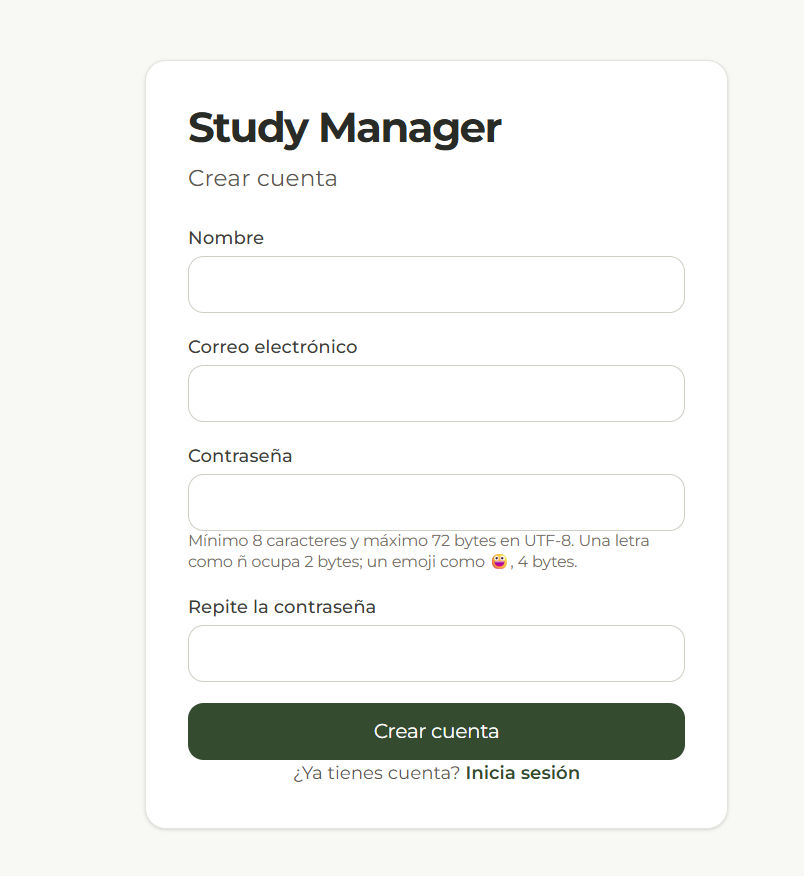
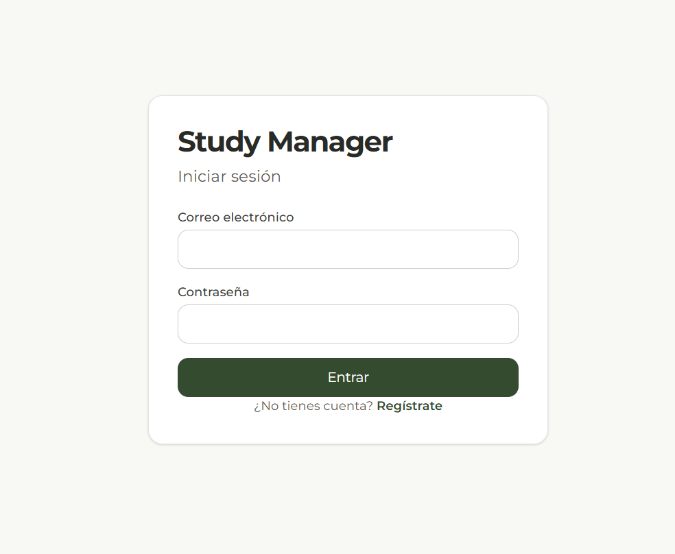
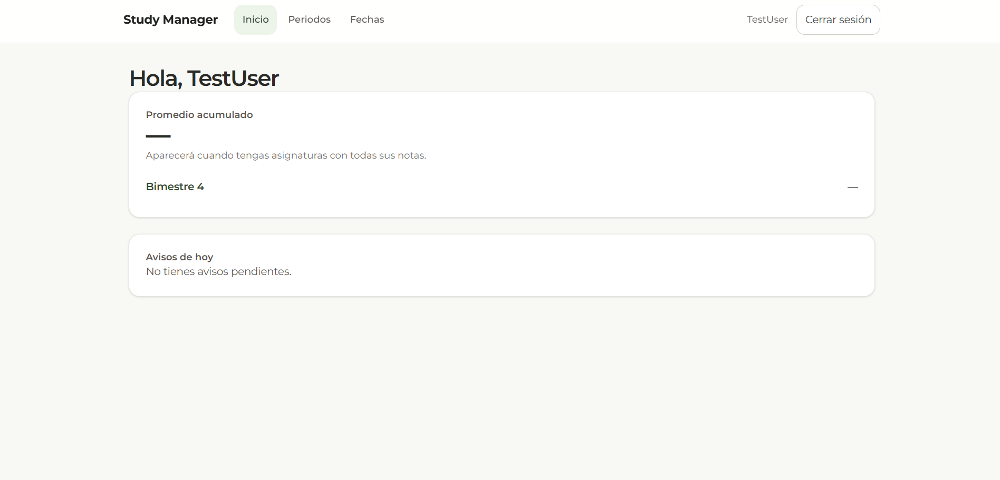
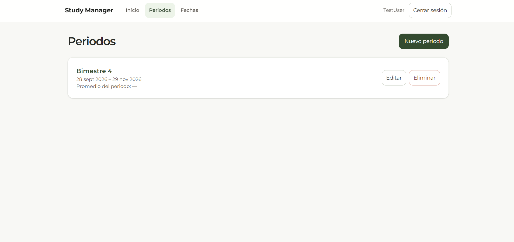
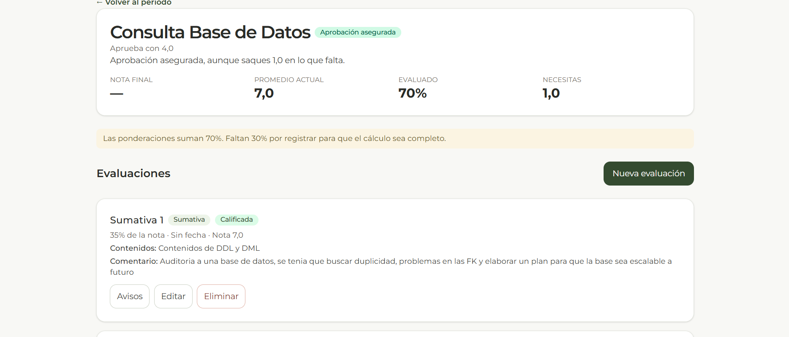
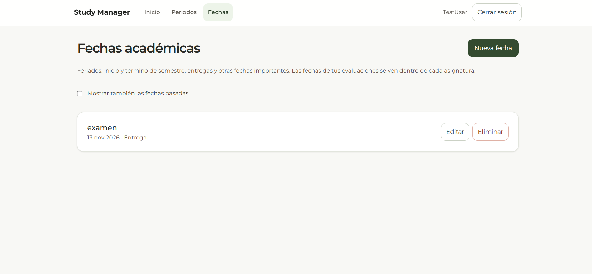

# study-manager

Gestor de estudios y entregas: periodos, asignaturas, evaluaciones con ponderaciones, notas,
promedio necesario para aprobar, fechas académicas y recordatorios.

- **Backend:** Java 21, Spring Boot, PostgreSQL (Docker) y migraciones con Flyway.
- **Frontend:** React con TypeScript (Vite), Tailwind CSS, React Router y TanStack Query.

## Capturas de la aplicación

Las siguientes capturas muestran las pantallas principales del frontend:

### Registro



### Inicio de sesión



### Inicio y avisos



### Periodos académicos



### Asignaturas


### Calificaciones y evaluaciones



### Fechas académicas



Estas capturas ilustran la interfaz. Los resultados de las pruebas automatizadas y de la
prueba de humo ejecutada están documentados en [el informe QA](docs/fixes/QA-EJECUCION.md).

## Requisitos

- Java 21 (por ejemplo Temurin, con [SDKMAN](https://sdkman.io)). Usa siempre la última
  actualización de la serie 21: las versiones anteriores a la 21.0.13 tienen una vulnerabilidad
  de certificados (CVE-2026-91403).
- Docker con Docker Compose (en Linux puede requerir `sudo`).
- Node 24 (última actualización) y pnpm 11 para el frontend.

## Puesta en marcha

### 1. Configuración

```bash
cp .env.example .env
```

Edita `.env`: cambia `DB_PASSWORD` y genera un secreto para `JWT_SECRET` (mínimo 32 caracteres),
por ejemplo con `openssl rand -base64 48`. El archivo `.env` está en `.gitignore` y no debe
subirse al repositorio.

`APP_TIME_ZONE` define la zona para calcular los días de los recordatorios; su valor por defecto
es `America/Santiago`. No depende de la zona horaria del servidor.

`DB_PORT=5433` selecciona el puerto local de PostgreSQL publicado por Docker y usado por
el backend y las pruebas. Así puede coexistir con un PostgreSQL instalado en Windows en
5432. Dentro del contenedor el puerto sigue siendo 5432. Si se omite `DB_PORT`, el backend
usa 5432; para la configuración local de Compose, copiar también esta variable del ejemplo.

### 2. Base de datos

```bash
docker compose up -d
docker compose ps        # espera a que diga "healthy"
```

### 3. Backend (http://localhost:8080)

```bash
./mvnw spring-boot:run
```

Flyway crea las tablas la primera vez.

### 4. Frontend (http://localhost:5173)

```bash
cd frontend
pnpm install --frozen-lockfile
pnpm dev
```

No uses `pnpm dev --host`: expondría el servidor de desarrollo a tu red.

Para apagar la base de datos conservando los datos: `docker compose down`.
`docker compose down -v` también borra los datos.

## Pruebas

```bash
./mvnw test                       # backend
cd frontend && pnpm test          # frontend
```

Las pruebas unitarias no necesitan nada más. Las **pruebas de integración** del backend usan la
base de datos levantada con Docker, pero una base **aparte** (`<DB_NAME>_test`) para no mezclar datos
con los tuyos. Se crea una sola vez:

```bash
docker compose exec db sh -c 'psql -U "$POSTGRES_USER" -d "$POSTGRES_DB" -c "CREATE DATABASE ${POSTGRES_DB}_test"'
```

La disponibilidad para integración se comprueba mediante una conexión JDBC real a la base
de pruebas, con `DB_USER` y `DB_PASSWORD`: un puerto abierto no basta. En modo local opcional,
si esa conexión no está disponible se omiten las pruebas que requieren PostgreSQL.
Con `TEST_DB_REQUIRED=true`, la falta de conexión hace fallar las pruebas en lugar de omitirlas;
CI usa este modo obligatorio. Flyway migra la base de pruebas automáticamente.

Con la aplicación en marcha también puedes ejecutar la prueba de humo, que recorre todos los
endpoints (deja datos de prueba en tu base de datos):

```bash
./scripts/smoke-test.sh
```

La [integración continua](.github/workflows/ci.yml) se configura para cada push y pull request:
Java 21 con Maven `verify` y PostgreSQL 16 de servicio; Node 24 con pnpm 11, instalación
con lockfile congelado, lint, pruebas y build. El servicio crea `study_manager_test` y el backend
usa `DB_NAME=study_manager` para resolver la base con sufijo `_test`. Solo usa credenciales
desechables de CI, sin secretos de producción y con permiso `contents: read`.
[Dependabot](.github/dependabot.yml) revisa Maven, npm/pnpm en `/frontend` y GitHub Actions
semanalmente, con `cooldown.default-days: 3` para actualizaciones de versión, no de seguridad.
La instalación conserva `minimumReleaseAge: 4320` (3 días) y no regenera el lockfile.
La configuración no implica que las comprobaciones ya hayan pasado: revisar el resultado de Actions.

## API

Todas las rutas, salvo las de autenticación y `/actuator/health`, exigen la cabecera
`Authorization: Bearer <token>`. Cada usuario solo ve y modifica sus propios datos: pedir un
recurso ajeno devuelve 404.

| Método | Ruta | Descripción |
|---|---|---|
| POST | `/api/auth/register` | Crear cuenta |
| POST | `/api/auth/login` | Obtener el token (dura 60 minutos) |
| GET | `/api/users/me` | Datos del usuario actual |
| POST, GET | `/api/terms` | Crear y listar periodos |
| GET, PUT, DELETE | `/api/terms/{id}` | Ver, editar y borrar un periodo |
| POST, GET | `/api/terms/{termId}/courses` | Crear y listar asignaturas de un periodo |
| GET, PUT, DELETE | `/api/courses/{id}` | Ver, editar y borrar una asignatura |
| POST, GET | `/api/courses/{courseId}/assessments` | Crear y listar evaluaciones |
| GET, PUT, DELETE | `/api/assessments/{id}` | Ver, editar y borrar una evaluación |
| POST, GET | `/api/assessments/{id}/reminders` | Crear y listar recordatorios de una evaluación |
| DELETE | `/api/reminders/{id}` | Borrar un recordatorio |
| GET | `/api/reminders/upcoming` | Avisos vigentes hoy |
| POST | `/api/reminders/{id}/dismiss` | Marcar un aviso como visto |
| POST, GET | `/api/academic-dates` | Crear y listar fechas académicas (`?from=&to=` opcionales) |
| GET, PUT, DELETE | `/api/academic-dates/{id}` | Ver, editar y borrar una fecha |
| GET | `/api/courses/{id}/summary` | Nota actual, nota final y promedio necesario |
| GET | `/api/terms/{id}/summary` | Promedio del periodo y resumen de sus asignaturas |
| GET | `/api/summary` | Promedio acumulado de todos los periodos |

Los `PUT` reemplazan el recurso completo: los campos que no se envían quedan vacíos.
El registro no inicia sesión automáticamente: tras crear la cuenta hay que iniciar sesión.

## Reglas de notas

- Las notas van de 1,0 a 7,0. Se aceptan dos decimales, pero **solo cuenta el primero, sin redondear**
  (5,57 se guarda como 5,5 y una nota final de 3,97 queda en 3,9).
- La nota de aprobación por defecto es 4,0 y se puede cambiar por asignatura.
- Las ponderaciones de una asignatura no pueden sumar más de 100% y solo puede haber un examen.
- El promedio necesario es lo que falta para llegar a la nota de aprobación, dividido por la
  ponderación pendiente, redondeado hacia arriba.
- El promedio de periodos y el acumulado son ponderados por créditos solo si todas las asignaturas
  tienen créditos; si falta alguno, es un promedio simple.
- Los créditos opcionales son enteros positivos, con máximo 32767 (tipo `Short` del backend).

## Seguridad

- Contraseñas cifradas con BCrypt (máximo 72 bytes).
- Autenticación sin sesiones, con JWT firmado (HS256) cuyo secreto sale de `JWT_SECRET`.
- Límite de intentos fallidos de login: 5 por cuenta desde una misma IP y 20 por IP, en 15 minutos;
  al superarlo, la API responde 429 con la cabecera `Retry-After`. El conteo vive en memoria y se
  reinicia con la aplicación. Se ajusta con `app.login.*` en `application.properties`.
- CORS abierto solo para el frontend (`CORS_ALLOWED_ORIGINS`, por defecto `http://localhost:5173`).
- Detrás de un proxy inverso, usar el perfil `proxy` solo con un proxy de confianza y sin acceso
  directo al backend; consultar el hallazgo 07 en el [índice de correcciones](docs/fixes/README.md).
- Las respuestas de error no incluyen trazas ni detalles internos.
- El token del frontend se guarda en `sessionStorage` (se borra al cerrar la pestaña).
- Frontend con pnpm: espera de 3 días antes de instalar versiones nuevas, scripts de instalación de
  dependencias bloqueados y dependencias desde Git o URLs rechazadas (`frontend/pnpm-workspace.yaml`).

## Correcciones documentadas

El [índice de los 11 hallazgos](docs/fixes/README.md) reúne el alcance de cada corrección,
sus comprobaciones y las precauciones de despliegue.
